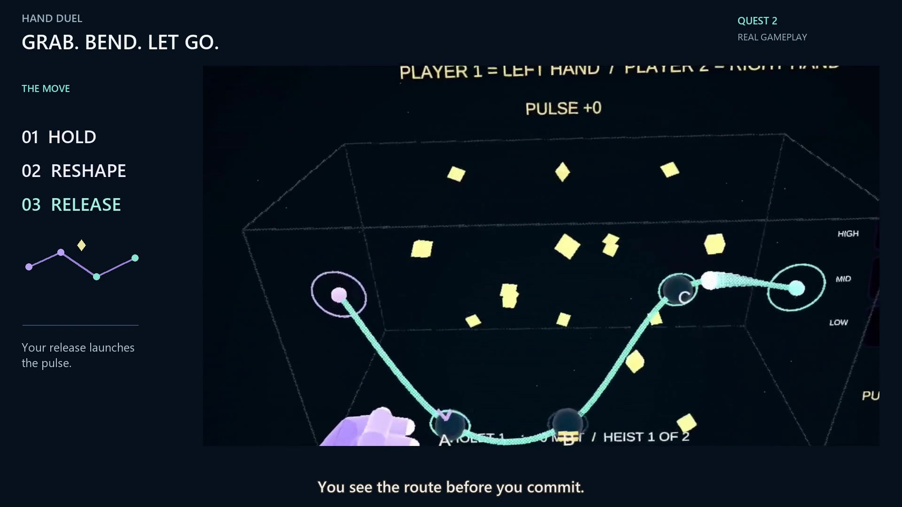
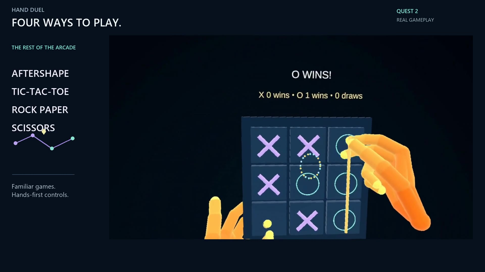

# Hand Duel: Borrowlight

**A seated, hands-only arcade for Meta Quest. Bend a shared ribbon of light, score what it touches, and hand your rival the route you leave behind.**

**[▶ Play it on Quest: join the Competition channel](https://www.meta.com/s/4ykAGmxTN)** (version 0.5.6, build code 17) ·
[Gameplay video (2:37, captioned)](web/media/demo.mp4) ·
[Install the APK](#install-the-apk-instead)



*Real Quest 2 footage. One person demonstrates both hand roles.*

Entry for the Meta VR Start Developer Competition 2026, built solo by Aryan Neopane in Unity.
Everything is played with bare hands: there are no controllers, accounts or network, and play works offline.

## The game

**Borrowlight** is a turn-based duel over one shared ribbon of light strung across a small arena.

1. **Hold.** Pinch a knot on the ribbon and hold it.
2. **Reshape.** Move your hand. The route redraws live, so you see exactly what it will touch before you commit.
3. **Release.** Letting go fires a pulse along the new route.

Scoring:

- A fresh light the pulse touches is yours: **+1**.
- A light your rival owns can be stolen: **+2**. A stolen light burns out and can't be taken again.
- The knot you just moved cools for one turn, so your rival has to play the route you left them.

Every move rearranges the board for the next player.

### Four ways to play

| Mode | Who | How |
|---|---|---|
| **Play with bot** | 1 player | You against a sparring bot that plays by the same rule code. |
| **Pass the Quest** | 2 players | Take turns wearing the headset. |
| **Left vs right** | 2 roles, 1 headset | Your left hand is Player 1 and your right hand is Player 2. |
| **Learn one heist** | 1 player | A guided first round, one move at a time. |

The arcade also includes **Aftershape** (a falling-block duel: stack, rotate, clear rows), **Tic-tac-toe** and
**Rock Paper Scissors** (left hand against right, all nine matchups). Every game uses the same hand controls.



## How to play

| To do this | Do this |
|---|---|
| Choose a menu item | Touch it with a fingertip, or point your hand at it and pinch. |
| Move a knot | Pinch and hold it, move your hand, then let go. Releasing is the move, so there is no Send button. |
| Re-centre the board | Press **Centre**. |
| Leave a game | Press **Home**. |

**First game:** open Borrowlight and choose **Learn one heist**. Hold knot **B**, move it to the gold ring and release, then do the
same with **A**.

Sit at a table or desk with good, even lighting so the headset tracks your hands reliably.

## Install the APK instead

To sideload without the Competition channel, turn on developer mode on the headset, connect it by USB, and run:

```sh
adb install -r build/Hand-Duel-0.5.6.apk
adb shell am start -n com.keepsrunning.showofhands/com.unity3d.player.UnityPlayerActivity
```

The APK is publisher-signed. If you have a development build installed under a different signature, uninstall it
first. Uninstalling also deletes that build's local progress.

## How it's built

- **Engine:** Unity 6 (6000.0.66f2) through OpenXR. The build is ARM64 with Vulkan and targets Quest 2, 3 and 3S.
- **Hand input** (`Runtime/Input`): each hand is read as 26 OpenXR joints. A bare hand is preferred over a controller left on the desk.
  Pinches use hysteresis, so tracking jitter doesn't drop or repeat a grab, and a hand that loses tracking counts as no move.
- **Deterministic rules** (`BorrowlightGame.cs`, `ArcadeModels.cs`, `RpsRound.cs`): plain C# with no clock and no
  physics. Players, the bot and the tests all call the same action functions, so a rule bug shows up in the
  tests instead of on the headset.
- **Everything drawn in code** (`Runtime/Render`, `Runtime/UI`): meshes, the six hand "gloves" and the UI are generated at
  runtime. The app ships no 3D model files.
- **Hand clips** (`Runtime/Clip`, `contract/`): a compact binary recording format for two-handed motion (26 joints at
  30 fps, 30–300 frames). `contract/tools/handclip.py` is a dependency-free Python reference implementation that writes
  the sample clips in `contract/samples/` and validates any clip (`python3 contract/tools/handclip.py check <clip.json>`).

### Tests

On a clean checkout, the Android APK builds and **all 80 EditMode tests pass**. They cover the Borrowlight rules on
every route, the arcade games, all nine Rock Paper Scissors matchups, the clip codec's round-trip, and hand-pointer
geometry. Another **21 simulated gameplay flows** (PlayMode) passed during app testing. Physical testing was on
Quest 2. Quest 3 and 3S are build targets but haven't been tested on a device.

## Build from source

You need Windows and **Unity 6000.0.66f2** with Android Build Support (SDK, NDK and OpenJDK).

1. Open `game/` in Unity, let the pinned packages restore, and switch the platform to Android.
2. Close Unity, then run:

   ```powershell
   ./game/tools/Build-Quest.ps1 -Unity 'PATH/TO/Unity.exe'
   ```

3. The result is `game/Builds/ShowOfHands.apk`, signed with a development certificate (release keys aren't in the repo).
   Diagnostic and benchmark flags are stripped from normal builds.

The static project page is in `web/`. To preview it, run `python3 -m http.server 8080 --directory web`.

## Repository layout

```
game/        Unity project: Runtime (rules, input, render, UI, clips), Editor tools, Tests
build/       Signed release APK (0.5.6)
contract/    Hand clip format: Python reference tool and sample clips
web/         Project page and the captioned gameplay video
docs/        Screenshots used in this README
licences/    Third-party notices (Noto Emoji OFL, three.js MIT)
```
